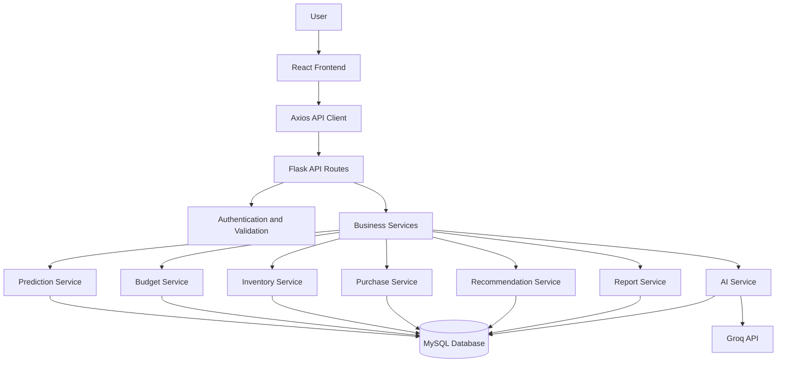

# Smart AI-Based Grocery List Optimiser for Indian Households

**GrocerySmart** is a full-stack grocery planning application designed for Indian households. It helps families manage grocery items, track inventory, understand consumption patterns, predict future requirements, optimise shopping within a budget, and generate personalised AI-powered shopping recommendations.

The application combines machine learning, rule-based optimisation, and generative AI to make grocery planning more organised and explainable.

```text
Household Setup
      ↓
Grocery Catalogue & Inventory
      ↓
Purchase and Consumption History
      ↓
ML-Based Consumption Prediction
      ↓
Inventory Stock Adjustment
      ↓
Budget Optimisation
      ↓
Final Shopping List
      ↓
AI-Powered Shopping Insights
```

## 1. Key Features

| Module | Description |
|---|---|
| Authentication | User registration, login and logout with password hashing, JWT cookies and CSRF protection. |
| Household Management | Configure family size, shopping frequency, monthly budget and planning period. |
| Grocery Catalogue | Add, edit, search, filter, sort and manage grocery items with categories, units, prices and priorities. |
| Inventory Management | Track available stock, update quantities, monitor low-stock items and manage expiry dates. |
| Purchase History | Record purchases, track expenditure and automatically update inventory. |
| Consumption Tracking | Record household consumption and maintain consumption history. |
| ML Prediction | Predict future grocery requirements using Simple Moving Average, Weighted Moving Average and Linear Regression forecasting approaches. |
| Stock Adjustment | Subtract available inventory from predicted requirements to calculate purchasing quantities. |
| Budget Optimisation | Reduce Optional and Important items according to deterministic budget rules while protecting Essential items. |
| Shopping List | Generate an interactive shopping checklist with quantities, prices and purchase tracking. |
| Dashboard | View household statistics, budget status, spending, inventory alerts and consumption information. |
| AI Insights | Generate natural-language insights based on household grocery and spending information. |
| AI Shopping Assistant | Ask grocery-related questions using a Groq-powered conversational assistant. |
| AI Recommendations | Generate personalised shopping recommendations using the latest saved plan and inventory information. |
| Reports | View spending trends, consumption information and shopping plan history. |
| Feedback | Submit ratings and optional comments about the application. |

## 2. Technology Stack

| Layer | Technology |
|---|---|
| Frontend | React 19, JavaScript, Vite |
| Styling | Tailwind CSS v4 |
| Routing | React Router |
| HTTP Client | Axios |
| Icons | Lucide React |
| Charts | Recharts |
| Notifications | React Hot Toast |
| Markdown Rendering | React Markdown, Remark GFM |
| Backend | Python, Flask |
| ORM | Flask-SQLAlchemy |
| Database Migration | Flask-Migrate |
| Authentication | Flask-JWT-Extended |
| Security | Werkzeug, CSRF protection, Flask-Limiter |
| Database | MySQL 8 |
| Data Processing | Pandas, NumPy |
| ML Forecasting | SMA, WMA and Linear Regression |
| Generative AI | Groq API |
| Testing | Pytest |

## 3. System Architecture

The application follows a layered architecture that separates the frontend, API routes, business logic, database operations and AI services.



### Architecture responsibilities

- **Frontend:** Displays application pages, forms, dashboards, charts and AI-generated responses.
- **API routes:** Validate requests, enforce authentication and household ownership, and coordinate service operations.
- **Services:** Contain prediction, inventory, purchasing, budget and recommendation logic.
- **AI service:** Communicates with Groq to generate insights, conversational answers and shopping recommendations.
- **Database:** Stores user accounts, household information, grocery items, inventory, purchases, consumption records and saved plans.

The frontend communicates with Flask through REST API endpoints.

## 4. Folder Structure

```text
smart-grocery-optimiser/
│
├── backend/
│   ├── app/
│   │   ├── __init__.py
│   │   ├── config.py
│   │   ├── constants.py
│   │   ├── extensions.py
│   │   ├── demo_data.py
│   │   │
│   │   ├── models/
│   │   │   ├── user.py
│   │   │   ├── household.py
│   │   │   ├── grocery_item.py
│   │   │   ├── inventory.py
│   │   │   ├── purchase.py
│   │   │   ├── consumption.py
│   │   │   ├── recommendation.py
│   │   │   └── feedback.py
│   │   │
│   │   ├── routes/
│   │   │   ├── auth_routes.py
│   │   │   ├── household_routes.py
│   │   │   ├── grocery_routes.py
│   │   │   ├── inventory_routes.py
│   │   │   ├── purchase_routes.py
│   │   │   ├── consumption_routes.py
│   │   │   ├── prediction_routes.py
│   │   │   ├── budget_routes.py
│   │   │   ├── dashboard_routes.py
│   │   │   ├── feedback_routes.py
│   │   │   └── ai_routes.py
│   │   │
│   │   ├── services/
│   │   │   ├── prediction_service.py
│   │   │   ├── budget_service.py
│   │   │   ├── inventory_service.py
│   │   │   ├── purchase_service.py
│   │   │   ├── recommendation_service.py
│   │   │   ├── report_service.py
│   │   │   └── ai_service.py
│   │   │
│   │   └── utils/
│   │
│   ├── migrations/
│   ├── scripts/
│   ├── tests/
│   ├── run.py
│   ├── requirements.txt
│   └── .env.example
│
├── frontend/
│   ├── src/
│   │   ├── api/
│   │   ├── assets/
│   │   ├── components/
│   │   ├── context/
│   │   ├── hooks/
│   │   ├── layouts/
│   │   ├── pages/
│   │   ├── utils/
│   │   ├── App.jsx
│   │   ├── main.jsx
│   │   └── index.css
│   │
│   ├── public/
│   ├── vite.config.js
│   ├── package.json
│   └── .env.example
│
├── database/
│   ├── schema.sql
│   └── seed_data.sql
│
└── README.md
```

## 5. Database Design

The application uses MySQL to maintain persistent household and grocery information.

Main entities include:

| Table | Purpose |
|---|---|
| users | Stores user accounts and password hashes. |
| households | Stores household information and budget settings. |
| grocery_items | Maintains the grocery catalogue. |
| inventory | Tracks current stock and expiry information. |
| stock_movements | Records stock changes and their reasons. |
| purchases | Stores purchase history and expenditure. |
| consumption | Stores household consumption records. |
| recommendations | Stores generated grocery plans. |
| recommendation_items | Stores individual items and quantities in each plan. |
| feedback | Stores user ratings and comments. |

Household-specific records are associated with the appropriate household. Backend ownership checks prevent users from accessing another household's records.

## 6. How the Core Logic Works

### 6.1 ML-Based Consumption Prediction

The prediction service analyses historical consumption records to estimate future grocery requirements.

The forecasting approaches implemented include:

**Simple Moving Average (SMA)**

Calculates the average consumption over selected historical periods.

\[
SMA = \frac{x_1+x_2+\cdots+x_n}{n}
\]

**Weighted Moving Average (WMA)**

Assigns different weights to historical observations so that selected recent periods can have greater influence.

\[
WMA = \frac{\sum_{i=1}^{n}w_ix_i}{\sum_{i=1}^{n}w_i}
\]

**Linear Regression**

Uses historical observations to estimate a trend and forecast future consumption.

The service supports per-item forecasting and uses available historical information to determine suitable predictions and fallback behaviour.

### 6.2 Inventory Adjustment

After predicting future consumption, the system subtracts the available inventory.

\[
Purchase\ Quantity = \max(0, Predicted\ Requirement-Current\ Stock)
\]

Example:

- Predicted rice requirement: 8 kg
- Current stock: 3 kg
- Recommended purchase: 5 kg

The application also handles quantity rounding according to the item's unit.

### 6.3 Budget Optimisation

The budget service uses deterministic, rule-based optimisation.

1. Calculate the budget for the selected planning period.
2. Compare the predicted shopping cost against the available budget.
3. Reduce Optional items first.
4. Reduce Important items next.
5. Protect Essential items from silent removal.
6. Recalculate the total after each adjustment.

If Essential items alone exceed the available budget, the plan reports the shortfall instead of silently removing them.

**Important:** Budget optimisation is rule-based, not a generative AI decision or a mathematically optimal basket solver.

### 6.4 Inventory and Purchase Management

- Recording a purchase can increase inventory.
- Recording consumption can decrease inventory.
- Editing or deleting transactions reconciles their previous stock changes.
- Stock cannot become negative.
- Database transactions help ensure related changes are committed or rolled back together.

### 6.5 Generative AI Integration

The application integrates the Groq API through a dedicated backend AI service.

It provides three main capabilities:

**AI Insights**
- Analyses household grocery information.
- Explains spending and inventory conditions.
- Generates useful household grocery insights.

**AI Shopping Assistant**
- Accepts grocery-related questions.
- Uses household context to generate conversational responses.
- Supports conversation history.

**AI Shopping Recommendations**
- Uses the latest saved shopping plan and inventory.
- Generates natural-language purchase recommendations.
- Explains shopping priorities and inventory alerts.

The AI service generates explanatory content. The actual inventory calculations, ML forecasts and budget optimisation remain controlled by backend business logic.

AI-generated content should be treated as assistance, not as a replacement for verified database calculations.

## 7. Setup on Windows

### Prerequisites

| Software | Requirement |
|---|---|
| Python | 3.11 or newer |
| Node.js | 20 LTS or newer |
| MySQL | 8.x |
| VS Code | Recommended editor |

Verify installation:

```powershell
python --version
node --version
npm --version
mysql --version
```

### Step 1: Clone the repository

```powershell
git clone https://github.com/sambit31/smart-grocery-optimiser.git

cd smart-grocery-optimiser
```

Use your actual GitHub repository URL if the repository has a different name.

### Step 2: Create the MySQL databases

Open MySQL Command Line Client and execute:

```sql
CREATE DATABASE smart_grocery
CHARACTER SET utf8mb4
COLLATE utf8mb4_unicode_ci;

CREATE DATABASE smart_grocery_test
CHARACTER SET utf8mb4
COLLATE utf8mb4_unicode_ci;
```

The test database is optional when running tests against the default isolated test database.

### Step 3: Configure the backend

```powershell
cd backend

python -m venv .venv

.\.venv\Scripts\Activate.ps1

pip install -r requirements.txt
```

Create your environment file:

```powershell
Copy-Item .env.example .env

notepad .env
```

Configure the required database connection, Flask secrets, JWT settings, CORS settings and other application configuration according to `config.py` and `.env.example`.

For Groq integration, configure:

```env
GROQ_API_KEY=your_groq_api_key
```

Get an API key from:

https://console.groq.com/

Never commit your real API key or `.env` file to GitHub.

### Step 4: Create database tables

Run the database migrations:

```powershell
flask --app run.py db upgrade
```

### Step 5: Configure the frontend

Open another PowerShell terminal:

```powershell
cd frontend

npm install

Copy-Item .env.example .env
```

Configure the frontend API base URL according to the provided environment template.

## 8. Running the Application

The application requires two terminals during local development.

**Terminal 1: Backend**

```powershell
cd backend

.\.venv\Scripts\Activate.ps1

python run.py
```

The backend runs on:

```text
http://127.0.0.1:5000
```

**Terminal 2: Frontend**

```powershell
cd frontend

npm run dev
```

The frontend runs on:

```text
http://localhost:5173
```

Open the frontend URL in your browser.

### Production frontend build

```powershell
cd frontend

npm run build
```

The generated production files are stored in `frontend/dist/`.

## 9. Sample Demonstration Workflow

A suggested demonstration for a college project presentation or viva:

1. Register a new household account or log in.
2. Configure family size, shopping frequency and monthly budget.
3. Add grocery items with categories, units, prices and priorities.
4. Add available inventory and expiry information.
5. Record purchase history.
6. Add consumption records for household grocery items.
7. Generate ML-based consumption predictions.
8. Compare predicted requirements against available stock.
9. Generate and optimise the grocery plan.
10. Open the shopping list and update item quantities.
11. Mark an item as purchased and verify the inventory update.
12. Open AI Insights to view household analysis.
13. Ask grocery-related questions through the AI Shopping Assistant.
14. Generate AI Shopping Recommendations.
15. Review spending, consumption and shopping plan reports.

## 10. API Endpoint Summary

All endpoints use the `/api` prefix.

### Authentication

| Method | Endpoint | Description |
|---|---|---|
| POST | `/api/auth/register` | Register a user |
| POST | `/api/auth/login` | Authenticate a user |
| POST | `/api/auth/logout` | Log out |
| GET | `/api/auth/me` | Retrieve current user |

### Household and Grocery Management

| Method | Endpoint | Description |
|---|---|---|
| GET / POST / PUT | `/api/household` | Household management |
| GET / POST | `/api/groceries` | List or create grocery items |
| GET / PUT / DELETE | `/api/groceries/<id>` | Retrieve, update or delete a grocery item |
| GET / POST | `/api/inventory` | Retrieve or create inventory records |
| PUT | `/api/inventory/<id>` | Update inventory |
| PATCH | `/api/inventory/<id>/quantity` | Adjust stock quantity |

### Purchases and Consumption

| Method | Endpoint | Description |
|---|---|---|
| GET / POST | `/api/purchases` | Retrieve or record purchases |
| GET / PUT / DELETE | `/api/purchases/<id>` | Manage purchase records |
| GET / POST | `/api/consumption` | Retrieve or record consumption |
| PUT / DELETE | `/api/consumption/<id>` | Update or delete consumption |

### Prediction and Budget

| Method | Endpoint | Description |
|---|---|---|
| POST | `/api/predictions/generate` | Generate a grocery prediction plan |
| GET | `/api/predictions/latest` | Retrieve the latest plan |
| GET | `/api/recommendations` | Retrieve saved plans |
| POST | `/api/recommendations/<id>/optimise-budget` | Optimise a saved plan |
| PATCH | `/api/recommendations/<id>/items/<line_id>` | Update a plan item |
| POST | `/api/recommendations/<id>/items/<line_id>/mark-purchased` | Record a plan item as purchased |

### Dashboard, Reports and AI

| Method | Endpoint | Description |
|---|---|---|
| GET | `/api/dashboard/summary` | Dashboard information |
| GET | `/api/reports/spending` | Spending reports |
| GET | `/api/reports/consumption` | Consumption reports |
| GET | `/api/reports/recommendations` | Recommendation history |
| POST | `/api/ai/insights` | Generate AI household insights |
| POST | `/api/ai/chat` | Ask the AI shopping assistant |
| POST | `/api/ai/recommendations` | Generate AI shopping recommendations |

### Feedback and Health

| Method | Endpoint | Description |
|---|---|---|
| GET / POST | `/api/feedback` | Retrieve or submit feedback |
| GET | `/api/health` | Check backend health |

Authenticated endpoints require the appropriate authentication and CSRF protections. Household-scoped endpoints enforce household ownership.

## 11. Testing

The backend uses Pytest.

Run the tests:

```powershell
cd backend

.\.venv\Scripts\Activate.ps1

python -m pytest -v
```

The previously reported test suite completed with:

```text
45 passed
```

The tests cover areas including authentication, household ownership, grocery management, inventory, purchases, consumption, prediction calculations, budget optimisation, shopping plan operations and database transaction handling.

Run the test suite again before publishing to confirm the current test count and results.

The frontend can be checked using:

```powershell
cd frontend

npm run build
```

Manual testing should also cover login, dashboard, grocery management, inventory, consumption, prediction, budget optimisation, shopping list, AI features and reports.

## 12. Security

Security measures implemented in the application include:

- Password hashing using Werkzeug.
- JWT authentication using HttpOnly cookies.
- CSRF protection using a double-submit token.
- Household-level data ownership checks.
- Backend request validation.
- Rate limiting for authentication endpoints.
- SQLAlchemy ORM for database operations.
- Restricted CORS configuration.
- Environment-based configuration for secrets and credentials.
- Generic API error responses rather than exposing server stack traces.

For production deployment:

- Use HTTPS.
- Enable secure JWT cookies.
- Use strong, randomly generated secrets.
- Disable Flask debug mode.
- Keep API keys and database credentials outside source control.
- Configure production CORS origins explicitly.

## 13. Troubleshooting

| Problem | Possible solution |
|---|---|
| PowerShell blocks virtual environment activation | Run `Set-ExecutionPolicy -Scope CurrentUser RemoteSigned`. |
| MySQL connection fails | Verify MySQL is running and check database credentials in `.env`. |
| Unknown database error | Create the `smart_grocery` database. |
| Frontend cannot reach backend | Start Flask on the configured port and verify the Vite proxy. |
| Missing CSRF token | Check the frontend API base URL and cookie configuration. |
| Groq API error | Check the API key, account access and supported model configuration. |
| AI response fails | Check backend logs and confirm Groq connectivity. |
| Prediction needs more data | Add consumption history or the supported initial estimate. |
| Frontend build fails | Run `npm install` and inspect the build error. |

## 14. Known Limitations

- Prediction quality depends on the availability and consistency of historical consumption data.
- Grocery prices are entered by users; there is no live supermarket price integration.
- Forecasting cannot reliably anticipate unexpected events or sudden changes in household consumption.
- Budget optimisation uses deterministic rules rather than a mathematically optimal shopping algorithm.
- Automatic grocery unit conversion is not supported.
- AI-generated recommendations can contain inaccuracies and should be reviewed by the user.
- Groq AI features require a valid API key and network access.
- The current household model supports one household per user rather than shared multi-user household accounts.

## 15. Future Enhancements

Potential future improvements include:

- Festival and seasonal consumption forecasting.
- More advanced forecasting model evaluation using historical data.
- Live grocery price comparison.
- Shared household accounts.
- Automatic unit conversion.
- Expiry notifications and reminders.
- PDF shopping list export.
- WhatsApp shopping list sharing.
- Progressive Web App support for offline shopping.

## Academic Project

Developed as an academic full-stack project.

The application demonstrates the integration of web development, database management, machine learning, business-rule optimisation and generative AI in a practical grocery management system.

**GitHub:** https://github.com/sambit31/smart-grocery-optimiser
